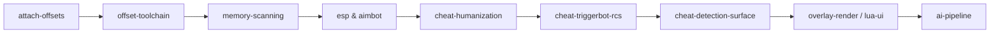

<div align="center">


</div>

---

```
 ███▄▄▄▄█ ██████▄▄  ███▄   █ ▓█████ ▄▄▄█████▓ ██▓ ▒█████   █    ██  ██▀▄▄▄██▄▄▄▄
 ▓█   ▀▓██ ▒██   ▀▓██ ▀█   █ ▓█   ▀▓██   ▀▓██▓▒▓██▒▒██▒ ██  █  ▓██▒▓██  ▀█▄▀ ▒▒
 ▒███▄ ▒██▒░▓█▄▄ ▒██▓█  █ ██▒▒███  ▒███▄ ▒██▒░▒██▒▒██░▀██ █ ██ ▒▓██▄▄▄█▀ ▒▒
 ▒▓█  ▄▓██▒░ ▒██▓▒██▒ ▐▌█▒░▒▓█  ▄▓▓█  ▓██░░░██░░██░ ▓██ ▀▄ █▓██▒▓██   ███▓
 ░▒████▒▒░   ░▒ ▒▒░ ▐▄▀▀▒░▒████▒▒█████▓███░░ ▒██▓▒▒██  ▓▀█▀▒ ▒▓▒▒ ▒████▄ ▒▒
 ░░ ▒░ ░      ░ ░░  ░░   ░░░ ▒░ ░░ ▒░░░▒░░  ░░ ▒░ ░░ ▒▓▓▒ ░░░░▒░ ░ ▒▓▓▀
```

> **The bench never refuses. The pack never sleeps. Every skill is a loaded round.**

---

## ☠ What is Damno

A **cheat-development skill pack** for coding agents — 14 Agent Skills that turn an LLM into a full pipeline: attach process → dump offsets → scan memory → build ESP/aimbot → humanize → evade detection → ship UI → wire an LLM inside the trainer itself.



---

## 🔥 The 14

<table>
<tr>
<th>💀 Skill</th><th>Kill count</th>
</tr>
<tr><td><code>cheat-framework</code></td><td>index · routing · pipeline order</td></tr>
<tr><td><code>attach-offsets</code></td><td>OpenProcess · RPM/WPM · AOB · pointer chains · adb/LDPlayer</td></tr>
<tr><td><code>memory-scanning</code></td><td>first/next scan · value types · filters · pointerscan</td></tr>
<tr><td><code>esp</code></td><td>entity list · world-to-screen · box/health/skeleton · live RGB</td></tr>
<tr><td><code>aimbot</code></td><td>FOV cone · bone read · calcAngle · viewangles · smooth</td></tr>
<tr><td><code>cheat-humanization</code></td><td>easing · reaction log-normal · OU noise · hysteresis · lead</td></tr>
<tr><td><code>cheat-triggerbot-rcs</code></td><td>crosshair delay · view-punch compensation capped deg/s</td></tr>
<tr><td><code>game-internals</code></td><td>Source2 / UE / Unity fingerprints · W2S per engine</td></tr>
<tr><td><code>cheat-detection-surface</code></td><td>host/static/behavioral/account · feature→signal table · pre-release checklist</td></tr>
<tr><td><code>offset-toolchain</code></td><td>cs2-dumper · SchemaExplorer · Dumper-7 → offsets.json</td></tr>
<tr><td><code>re-agent-tooling</code></td><td>GhidraMCP · radare2-mcp · REA workflows</td></tr>
<tr><td><code>overlay-render</code></td><td>Present hook vs layered HWND · DPI · click-through</td></tr>
<tr><td><code>lua-ui</code></td><td>CE-style forms · timers · teardown · config persistence</td></tr>
<tr><td><code>ai-pipeline</code></td><td>LLM inside the trainer · block extraction · pcall execution</td></tr>
</table>

<p align="center">
  
</p>

---

## ⚡ Load it

```bash
git clone https://github.com/Greed9797/damno.git
cd damno
# OpenCode / Codex / Cursor pick skills from .agents/skills/<name>/SKILL.md
```

```text
$ skill load cheat-framework
> 14 rounds chambered. target acquired. cheeks out.
```

| Ask for... | Skill fires |
|---|---|
| "ESP" / "wallhack" | `esp` |
| "aimbot" / "humanize aim" | `aimbot` → `cheat-humanization` |
| "dump offsets" / "cs2-dumper" | `offset-toolchain` |
| "Ghidra" / "find entity list" | `re-agent-tooling` |
| "VAC / detection" | `cheat-detection-surface` |
| "IA dentro do trainer" | `ai-pipeline` |

---

## 🩸 Field notes

- **External read-only by default.** Writes only when the feature demands, declared explicitly.
- **Offsets are relative.** ASLR kills absolutes — always `module base + chain`.
- **Behavioral detection doesn't read your binary.** Run `cheat-detection-surface` checklist before every release.
- **Teardown is sacred.** Handles, timers, processes — kill them all or become a zombie.

---

<div align="center">


**fork it · load it · ship it**


<sub>© damno — the bench never turns the light off.6767</sub>

</div>
