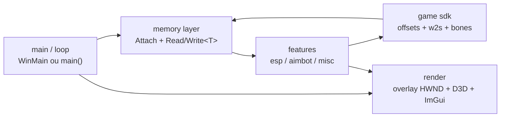
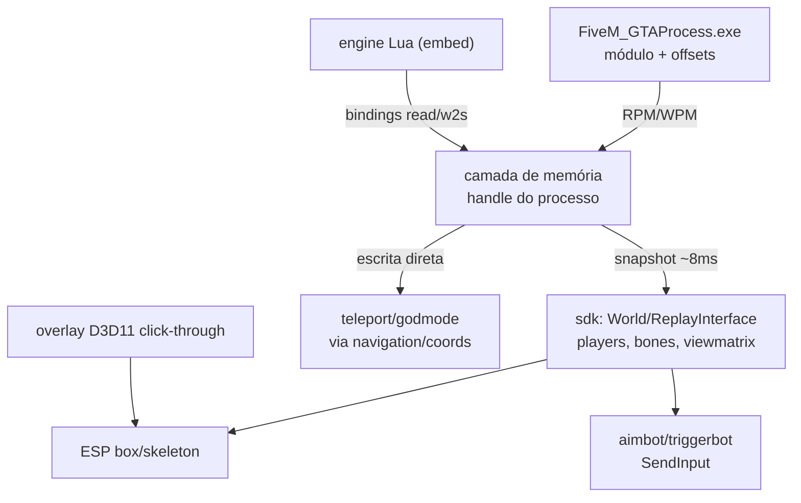
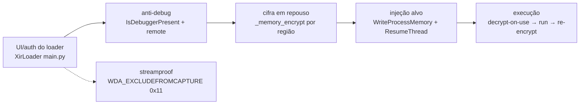
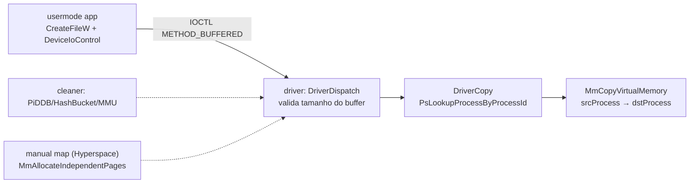

# Architecture — mapa por categoria

## 1. External cheat típico (processo separado)

Legenda: um processo externo, sem injeção — tudo passa pela camada de memória; render é janela própria por cima do jogo. Base: huguluhu `src/main.cpp:143-199`, Device9999 `gta_external.cpp` + `overlay/overlay.cpp`.

## 2. FiveM external (jogo ↔ cheat)

Legenda: **nenhum repo da lista usa pipe nem invocação de natives do FiveM** — tudo é R/W direto ou `SendInput`; teleport = escrever coordenada (Device9999 `esp/esp.cpp:147-148`). Lua, quando existe, é embutido no processo do cheat, não no jogo (huguluhu `lua_engine.cpp`).

## 3. Loader streamproof (stub → decrypt → execução)

Legenda: loader em memória cifrada, só decripta na execução; janela do loader marcada como excluída de captura. Base: XirLoader `main.py:26035-26104`, `:29591`, `:31276`. Caminho alternativo (driver, não vi nesta categoria): Hyperspace `bootstrapper/src/map/map.hxx` manual map.

## 4. Kernel driver (usermode → ioctl → driver → memória)

Legenda: canal mínimo de R/W em kernel (nkga `src/driver.c:27-95`); cleaner apaga rastros do driver depois do load; manual map evita DSE/`PsLoadedModuleList`. Seta pontilhada = complementa, não faz parte do caminho de dados.

## Decisões de design para o nosso pack

- **Rota externa por default.** Device9999 e huguluhu provam que ESP/aimbot/triggerbot/teleport funcionam só com RPM + SendInput — sem injeção, sem hook. `cheat-framework` deve tratar rota interna (padrão 8) como opcional.
- **`esp.md` confirmado:** box por 3 bones + skeleton por tabela de pares (huguluhu `esp.cpp:8-47`) é o padrão mais completo visto. Nenhum repo usa w2s com anti-snap/humanização — gap que `cheat-humanization` preenche sozinho.
- **Smoothing com resíduo sub-pixel** (huguluhu `aimbot.cpp:145-150`) é o detail que separa aimbot estável de aimbot tremido — incorporar no `aimbot` como default; suavização `floor/smooth/6.66` do fork khannedj/asshetys9 é o fallback legacy.
- **Triggerbot só existe em 1 repo** (huguluhu, integrado no aimbot com timer por dt). `cheat-triggerbot-rcs` não tem concorrência na lista — o spec vem do padrão 6.
- **Offsets: dois estilos, escolher um por alvo.** Pattern scan (internal, `dllmain.cpp:57-61`) vs bloco `namespace off` + retune runtime (external, `offsets.h` + Debug tab). Para o pack, bloco fixo + retune = `offset-toolchain`/`attach-offsets`; pattern = `memory-scanning`.
- **Overlay:** `WS_EX_TOPMOST|TRANSPARENT|LAYERED` + DWM margins é o mínimo vivo; **streamproof não é overlay** — é `SetWindowDisplayAffinity(WDA_EXCLUDEFROMCAPTURE)` em toda a árvore de HWNDs (XirLoader). Adicionar ao `overlay-render` como flag separada.
- **Canal kernel:** copiar o shape do nkga (1 IOCTL, 1 struct, buffered, validação de tamanho) para qualquer feature que precise de R/W sob EAC/BE. O cleaner (pads 11) é pós-load, não pré-requisito.
- **Descartar do pack:** auth/hwid/screenshot de cliente (XirLoader), READMEs que não batem com o código (khannedj "external", asshetys9 "Lua executor"), forks byte-idênticos (harrenscore, asshetys9), repos sem fonte (castellri/harrenscore).
