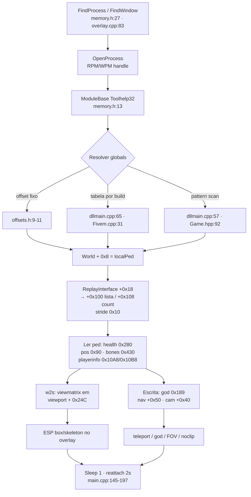

# FiveM Deep — arquitetura de cheats FiveM/GTA V (profundidade de código)

Aprofundamento sobre 9 repositórios clonados (3 da base anterior + 6 novos). Toda afirmação tem `repo arquivo:linha`. Siglas: **huguluhu** = huguluhu/fivem-external, **Device9999** = Device9999/FiveM-External-ESP, **khannedj** = khannedj/FiveM-Mod-Menu, **SilentAim** = vgszf/Fivem-External-SilentAim, **WeanteX** = HeaderW/WeanteX-FiveM-External.

## Visão geral

FiveM é mod multiplayer do GTA V (CitizenFX); para fins de cheat, o alvo é o processo que roda o engine GTA V dentro do FiveM. Processos observados no código: `FiveM_GTAProcess.exe` (huguluhu `src/main.cpp:124,163`; Device9999 `gta_external/overlay/overlay.cpp:96`), `FiveM_b<build>_GameProcess.exe` / `FiveM_b<build>_GTAProcess.exe` por build (SilentAim `Cheat/FivemSDK/Fivem.cpp:31-43`; khannedj `dllmain.cpp:65,83,101,119,137,155`), fallback `GTA5.exe` para o GTA vanilla (Device9999 `overlay/overlay.cpp:82`), e o match por substring `Process.exe` que cobre GameProcess/GTAProcess (WeanteX `WeanteX/Cheat/Game.hpp:55`). Externos = processo separado com `OpenProcess` + RPM/WPM + overlay próprio; internal = DLL dentro do processo com hook de `Present` (khannedj `Core.cpp:117`). Diferença GTA vanilla vs FiveM no código observado: nome do processo/módulo e offsets por build do FiveM — o mecanismo de leitura (RPM) é o mesmo.

## Arquitetura dos externos

Pipeline real extraído dos código (ordem do loop):

1. **Achar processo** — snapshot Toolhelp por nome (huguluhu `src/core/memory.h:27-39` `FindProcess`) ou por janela (`FindWindow("grcWindow")` → `GetWindowThreadProcessId`, Device9999 `overlay/overlay.cpp:83-97`; WeanteX `Game.hpp:38-60` `FindGame` varrendo `TH32CS_SNAPPROCESS`).
2. **Abrir handle** — `OpenProcess(PROCESS_VM_READ|VM_WRITE|VM_OPERATION|QUERY_INFORMATION)` com fallback read-only (huguluhu `memory.h:47-50`), `PROCESS_ALL_ACCESS` direto (Device9999 `overlay/overlay.cpp:100`; SilentAim `FrameWork/Utilities/Memory.cpp:152`; WeanteX `WeanteX/main.cpp:153`).
3. **Base do módulo** — `CreateToolhelp32Snapshot(TH32CS_SNAPMODULE)` + `Module32First/Next` (huguluhu `memory.h:13-25`; Device9999 `memory/memory.cpp:13-38`).
4. **Resolver globals** — três estratégias observadas: offset fixo em header (huguluhu `src/core/offsets.h:9-11`), tabela por build `if (GetModuleHandleA("FiveM_bXXXX_..."))` (khannedj `dllmain.cpp:65-170`; SilentAim `Fivem.cpp:31-430`), pattern scan com RIP-relative resolve (khannedj `dllmain.cpp:57-61`; WeanteX `Game.hpp:92-121` `FindPattern` lendo o módulo inteiro e resolvendo `addr + *(int32*)(addr+offset) + extra`).
5. **Local player** — `World + 0x8` (huguluhu `offsets.h:14`; Device9999 `esp/esp.cpp:109` lê `g::world_ptr + 0x8`; khannedj `Classes.hpp:806` `hk_World::LocalPlayer` = `*(u64*)(this+0x8)`; WeanteX `Cheat/Cheat.hpp:361` com `Offsets.LocalPlayer = 0x8` em `Game.hpp:142`).
6. **Iterar entidades** — `ReplayInterface → +0x18 (CPlayerInterface) → +0x100 (lista) / +0x108 (count int)`, stride `i * 0x10` (SilentAim `Classes.hpp:331,346,354`; khannedj `Classes.hpp:768-786`; WeanteX `Cheat.hpp:368-372`; Device9999 `esp/esp.cpp:165-166`). Exceção: huguluhu itera com stride `i * 8` (`src/game/sdk.cpp:136`) sobre `PlayerIfaceList = 0x100 // CPed** array` (`offsets.h:21-22`) — divergência de stride entre repos, ver Armadilhas.
7. **Ler estado por ped** — health/armor/posição/bones via offsets do bloco `off::` (huguluhu `sdk.cpp:139-161`) ou structs mapeadas (Device9999 `sdk/sdk.hpp:66-121`, SilentAim `Classes.hpp:131-324`).
8. **Desenhar/escrever** — ESP no overlay do próprio processo externo (huguluhu `src/features/esp.cpp:52-70` em `ImGui::GetBackgroundDrawList()`); escrita features em thread separada a cada 5 ms (Device9999 `features/features.cpp:194-206`) ou 1 ms + delay (SilentAim `Exploits.cpp:146`, `TriggerBot.cpp:13`).
9. **Reattach** — a cada 2 s checa `GetExitCodeProcess == STILL_ACTIVE` e reabre (huguluhu `memory.h:63-68` + `main.cpp:157-170`).

## Mapa de offsets/estruturas

Só o que apareceu no código (offset → campo). Convergências entre repos marcadas.

| Campo | Onde vi | Uso |
|---|---|---|
| `World` (base+X) | huguluhu `offsets.h:9` `0x25B14A0` · SilentAim `Fivem.cpp:49` `0x252DCD8` (b2372) · WeanteX `Game.hpp:137` `0x25EC580` (3570) · khannedj `dllmain.cpp:57` pattern `48 8B 05 ? ? ? ? 48 8B 48 08...` | ponteiro CWorld* |
| `ReplayInterface` (base+X) | huguluhu `offsets.h:10` `0x1FEAAC0` · SilentAim `Fivem.cpp:50` `0x1F05208` · WeanteX `Game.hpp:138` `0x1FB0418` · khannedj `dllmain.cpp:58` pattern | lista de entidades |
| `Camera/ViewPort` | huguluhu `offsets.h:11` `0x24C0B00` · Device9999 `esp.cpp:6` `0x0208BAF0`/`0x02087780` (steam/non-steam) · SilentAim `Fivem.cpp:51` `ViewPort = 0x1F9E9F0`, `:52 Camera = 0x1F9F898` · WeanteX `Game.hpp:139-140` | viewmatrix e câmera |
| viewmatrix no viewport | Device9999 `esp.cpp:7` `viewport + 0x24C` · SilentAim `Fivem.cpp:984-1008` WorldToScreen `pViewPort + 0x24C` · huguluhu `offsets.h:46` `ViewMatrixInCam = 0x24C` (probed, `sdk.cpp:33-59`) | w2s |
| `WorldLocalPlayer` | huguluhu `offsets.h:14` `0x08` · khannedj `Classes.hpp:806` `0x8` · WeanteX `Game.hpp:142` `0x8` | ped local |
| Ped list / count | huguluhu `offsets.h:21-24` `0x100`/`0x108` (players), `0x180`/`0x188` (vehicles) · SilentAim `Classes.hpp:346,354` `0x100`/`0x108` · khannedj `Classes.hpp:775-786` `0x100`/`0x108` · WeanteX `Cheat.hpp:368` `+0x100` · Device9999 `sdk.hpp:10-11` `0x0100`/`0x0108` | walk de entidades, stride `i*0x10` (huguluhu: `i*8`, `sdk.cpp:136`) |
| `EntityPosition` | huguluhu `offsets.h:27` `0x90` · Device9999 `sdk.hpp:77` `origin //0x0090` · khannedj `Classes.hpp:676` `this+0x90` · SilentAim `Classes.hpp:42,197` `0x90` · WeanteX não expõe (usa helpers) | coordenada XYZ |
| `EntityVelocity` | huguluhu `offsets.h:28` `0x30` · Device9999 `sdk.hpp:87` `velocity //0x0320` (diverge) | velocidade |
| `EntityHealth` | huguluhu `offsets.h:29` `0x280` float · Device9999 `sdk.hpp:81` `health //0x0280` · khannedj `Classes.hpp:702` `0x280` · SilentAim `Classes.hpp:58,213` `0x280` · WeanteX `Game.hpp:146` `Health = 0x280` | vida |
| `EntityMaxHealth` | huguluhu `offsets.h:30` `0x2A0` · Device9999 `sdk.hpp:83` `0x02A0` · SilentAim `Fivem.cpp:66` `MaxHealth = 0x2A0` · WeanteX `Game.hpp:147` `0x284` (diverge) | vida máx |
| `EntityArmor` | huguluhu `offsets.h:31` `0x150C` · Device9999 `sdk.hpp:112` `armor_amount //0x14B8` · khannedj `dllmain.cpp:68` `Armor = 0x14B8` (b2060+) · SilentAim `Fivem.cpp:59` `0x14E0` · WeanteX `Game.hpp:152` `0x150C` | colete |
| `EntityFlags` (invisible bit0) | huguluhu `offsets.h:32` `0x2E` (bit0) · Device9999 `sdk.hpp:69` `invisible //0x002C` e `features.cpp:80-84` escreve `0x2C` | invisibilidade |
| god mode byte | Device9999 `sdk.hpp:79` `god_mode //0x0189`, escrito em `features.cpp:75` · SilentAim `Classes.hpp:166-172` `godmode_on/off` → `this + 0x189` | god mode |
| `EntityPlayerInfo` | huguluhu `offsets.h:34` `0x10A8` · khannedj `dllmain.cpp:71` `PlayerInfo = 0x10B8` · SilentAim `Fivem.cpp:61` `0x10C8` · WeanteX `Game.hpp:144` `0x10A8` | CPlayerInfo* |
| `PlayerInfoName` | huguluhu `offsets.h:39` `0x40` char[32] · Device9999 `sdk.hpp:136` `name[20] //0x007C` | nome |
| `PlayerNetID` | SilentAim `Fivem.cpp:62` `0x88` | net id |
| `EntityWeaponMgr` / current / hash | huguluhu `offsets.h:35,42-43` `0x10B8` / `0x20` / `0x60` · khannedj `dllmain.cpp:70,75` `0x10C8`/`0x20` · SilentAim `Fivem.cpp:63` `0x10D8` · Device9999 `sdk.hpp:95` `weapon_manager_ptr //0x10C8`, `features.cpp:133` `+0x20` | arma atual |
| `EntityVehicle` (last vehicle) | huguluhu `offsets.h:36` `0x0D30` · Device9999 `sdk.hpp:89` `last_vehicle_ptr //0x0D28`, `features.cpp:7` `+0x0D28` · SilentAim `Fivem.cpp:67` `LastVehicle = 0xD30` · khannedj `Classes.hpp:632` `0xD30` | veículo atual |
| navigation +0x50 (coord de TP) | Device9999 `esp.cpp:147-148` escreve `navigation + 0x50` · SilentAim `Fivem.cpp:975` `WriteMemory(Navigation + 0x50, Position)` · khannedj `Classes.hpp:637` `ObjectNavigation() = *(ptr*)(this+0x30)` | teletransporte |
| ModelInfo +0x2C (freeze/stop) | SilentAim `Fivem.cpp:965-981` backup/restore `ModelInfo + 0x2C` · `Exploits.cpp:28,37-38` noclip zera/restaura `TPModelInfo + 0x2C` | pausar física no TP |
| camera view angles | SilentAim `Classes.hpp:421-434` `CCamFollowPedCamera Get/SetViewAngles` em `this + 0x40` | aimbot escreve ângulo |
| `CameraFov` | huguluhu `offsets.h:47` `0x30` (escrito em `misc.cpp:23-25`) | FOV changer |
| blip list / waypoint | Device9999 `esp.cpp:122` `base + 0x206B4E0`, scan 2000 × 8, blip `+0x40` icon / `+0x48` color / `+0x10` pos · SilentAim `Fivem.cpp:56` `BlipList = 0x1F9FFA0` + `Exploits.cpp:77-85` mesmo layout · WeanteX `Game.hpp:142` `BlipList = 0x2061870` | waypoint p/ teleport |
| weapon fields (no recoil/spread/etc) | khannedj `dllmain.cpp:72-79` `Recoil 0x2E8, Spread 0x74, ReloadMultiplier 0x12C, AmmoType 0x20, WeaponName 0x5E0, Range 0x25C` · Device9999 `features.cpp:138-156` `reload 0x12C, bullet_damage 0xB0, muzzle 0x114, range 0x28C, penetration 0x108, spread 0x2E8, recoil 0x74` | mods de arma |
| seatbelt | Device9999 `features.cpp:33-38` ped `+0x13EC` = `0xC9`/`0xC8` · `sdk.hpp:97` | cinto |
| run/swim speed | Device9999 `features.cpp:188-190` playerinfo `+0x14C` / `+0x0148` | velocidade |
| frame flags (explosive ammo/super jump) | Device9999 `features.cpp:90-94` playerinfo `+0x01F8` OR de bits | exploit flags |
| NOP patches (code) | Device9999 `features.cpp:110,122` `base + 0xEC58F1` (infinite ammo) e `+0xEC58AC` (no reload) — 3 bytes NOP `90 90 99` | patch de código via WPM |
| `HandleBullet` / silent aim | SilentAim `Fivem.cpp:55,100,145,190...` `HandleBullet = base + 0xFE7EF8` (b2372) — cave em `base + 0x34E` (`SilentAim.cpp:34`) com JMP `E9` (`SilentAim.cpp:59-66`) · WeanteX `Game.hpp:151` `Silent = 0x102D550`, `Cheat.hpp:1130,1150` RestoreSilent/ApplySilent | silent aim por patch de .text |
| `bIsPlayerAiming` / `PlayerAimingAt` | SilentAim `Fivem.cpp:53-54` `0x2BF7CF0` / `0x1FACDE0`; `IsPlayerAiming()` `Fivem.cpp` lê bool global; `GetAimingEntity()` lê ponteiro | triggerbot |
| `cash` / `wanted` | Device9999 `sdk.hpp:121` `cash //0x15D4` e `sdk.hpp:149` `wanted_data_ptr //0x0760` — **campos de struct nunca lidos/escritos em nenhum .cpp** | sem uso |
| fragment/bones | huguluhu `offsets.h:33` `EntityFragInst 0x430`, leitura em `sdk.cpp:88-95` (`frag+0x1A0` ou `+0x20` conforme `g::boneMode`, stride `boneStride=0x70`, `bonePosOff=0x10`, `globals.h:23-25`) · Device9999 `sdk.cpp:3-8` `ped+0x60` matriz + `ped+(0x430 + bone_id*0x10)` · SilentAim `Fivem.cpp:60` `BoneManager = 0x430`, `GetBonePosVec3` (`Fivem.cpp:741`) via `FragInsNmGTA = 0x1400` (`Fivem.cpp:64`) → `frag+0x68 → +0x178` crSkeletonData (cache `MaskToBoneId`) · WeanteX `Game.hpp:153` `BoneList = 0x410` | lookup de bone p/ ESP/aimbot |
| build tables | khannedj `dllmain.cpp:65-170` (b2060, b2189, b2372, b2545, b2612/b2699) · SilentAim `Fivem.cpp:31-430` (b2189, b2372, b2545, b2612, b2699, b2802, b2060, b2944, b3095) · WeanteX `Game.hpp:137-265+` (3570, 3407, 3323, 3258, 3095, 2944, 2802, 2699) | retune por versão |

## Features no código

### ESP
- **huguluhu** `src/features/esp.cpp:52-70`: snapshot de `sdk::players`, filtro local/distância, snapline do centro da tela, cor por invisível. Box por 3 bones (head 8, foot L 19, foot R 22) com fallback pé+90 px (`esp.cpp:22-47`); skeleton = tabela fixa de 20 pares bone-bone (`esp.cpp:12-18`). w2s por matriz 4×4 com validação `cw < 0.001` (`sdk.cpp:76-86`).
- **Device9999** `esp/esp.cpp:99` `draw_esp`: bounding box por 8 pontos projetados (`esp.cpp:35`), skeleton de 6 pares (`esp.cpp:80-93`), nome/distância/arma, lista de players via replay (`sdk/sdk.cpp:14-31`). w2s = viewmatrix do viewport com transpose (`esp.cpp:5-33`), sentinela `(0,0)`.
- **SilentAim** `Cheat/Features/Visuals/PlayerESP.cpp:38-136`: box por foot/head + skeleton completo por masks `SKEL_*` (`PlayerESP.cpp:44-136`), `VehicleESP.cpp` separado.
- **WeanteX** `Cheat/Cheat.hpp:534` `Draw::Esp()` + snapline/distance de veículo (`:1100,1113`), FOV circle do silent (`:428-454`).
- **Device9999 objeto ESP**: lista de hashes de props (weed/money bag/drugs) em `esp.cpp:303-330` (`prop_money_bag_01` `esp.cpp:317`) — ESP de objeto, não drop de dinheiro.

### Aimbot
- **huguluhu** `src/features/aimbot.cpp:51-96`: seleção por métrica de tela, FOV, prioridade, switch delay (`:96`); guarda de foreground (`:54`); aplica no **mouse** com smooth `delta/smooth` + clamp `maxStep` + acumulador de resíduo `s_remX/s_remY` (`:133-155`), `SendInput`/`SetCursorPos`.
- **Device9999** `aimbot/aimbot.cpp:4-27`: FOV fixo 25 px, bone 0 (head), `mouse_event` com `VK_XBUTTON2`.
- **khannedj** `Aimbot.hpp:16-95` seleção por distância/tela com `GetBonePosW2S(ped, 0x796e)` (`:80`); smooth comentado `floor(target/smooth)/6.66` (`Aimbot.hpp:361-365`), `mouse_event` (`:374`); `aimbot_silent` (`:124`) usa **natives** `PLAYER::PLAYER_PED_ID` / `WEAPON::GET_SELECTED_PED_WEAPON` (`:127-129`) — headers `native.hpp`/`includes.hpp`/`Settings.hpp` **ausentes do repo** (0 cópias no clone).
- **SilentAim** `AimBot.cpp:7-54`: alvo por FOV/distância/hitbox (head/neck/spine), chama `ProcessCameraMovement` (`Fivem.cpp:929-960`) que **escreve viewangles** em `CCamFollowPedCamera + 0x40` com smooth horizontal/vertical e correção de third-person (`Fivem.cpp:937-960`). **Silent aim real**: reescrita de `.text` — JMP `E9` de `HandleBullet` para cave em `base+0x34E` que faz `mov dword [r9+0/4/8], <xyz>` do fim do bala e volta (`SilentAim.cpp:29-90`); restore grava os bytes originais `F3 41 0F 10 19...` (`SilentAim.cpp:8-27`).
- **WeanteX** `Cheat.hpp:1150` `ApplySilent` / `:1130` `RestoreSilent` no offset `Offsets.Silent` — mesmo mecanismo de cave.

### Triggerbot
- **huguluhu** `aimbot.cpp:118-130`: alvo na mira dentro de raio (escala 1080p), `trigTimer += dt` até `triggerDelay`, `SendInput` LEFTDOWN|LEFTUP, saiu do raio zera.
- **SilentAim** `TriggerBot.cpp:9-85`: thread própria, checa `GetAimingEntity()` (lê global `PlayerAimingAt`), distância máxima, NPC/friend/visible, `IsPlayerAiming()` (bool global `bIsPlayerAiming`), `sleep(ReactionTime)` (`:66`) e `SendInput` LEFTDOWN/UP.

### Teleport
- Confirmado: **escrita de coordenada**, dois destinos — `Object + 0x90` (origem visual) e `Navigation + 0x50` (destino de navegação).
- **Device9999** waypoint: scan de blips `base+0x206B4E0` × 2000 (`esp.cpp:122-151`), filtra icon 8/color 84, escreve `nav+0x50` com z `-200` em loop de 5 (`esp.cpp:145-149`); teleport to player idem (`esp.cpp:203-209`, comentário do autor: "buggy af, needs to be looped").
- **SilentAim** `Exploits.cpp:95-140` `TeleportToWaypoint`: mesmo scan de blips (`BlipList + i*8`, `+0x40` icon, `+0x48` color, `+0x10` pos), z `-210`, escolhe veículo ou ped, `TeleportObject` (`Fivem.cpp:965-981`): backup `ModelInfo+0x2C` → zera (para física) → write `Object+0x90` e `Navigation+0x50` → sleep 40 ms → restaura.

### God / noclip / money / wanted
- **God**: byte `ped + 0x189 = 1` — Device9999 `features.cpp:74-75`; SilentAim `Classes.hpp:166-172`. Semi-god = refill health/armor por tick (Device9999 `features.cpp:97-105`; SilentAim `Exploits.cpp:169-172`). Vehicle god: byte `+0x189` + 4 campos de health (`features.cpp:23-28`).
- **Noclip**: só SilentAim `Exploits.cpp:13-71` — zera `ModelInfo+0x2C`, move `TPPosition` pelo vetor de `GetViewAngles()` com WASD/space/ctrl, chama `TeleportObject`.
- **Invisível**: `ped + 0x2C` = `0x1`/`0x37` (Device9999 `features.cpp:79-86`; khannedj `Classes.hpp` `SetInvisible` `0x2C`).
- **Money**: **nenhum repo escreve dinheiro**. Só o campo `cash //0x15D4` em Device9999 `sdk.hpp:121` (nunca usado) e README do khannedj `README.md:16` "Money Hack (removed unsafe)" — sem código.
- **Wanted**: **nenhum repo implementa**. Só `wanted_data_ptr //0x0760` (Device9999 `sdk.hpp:149`, sem uso) e o enum `CPED_CONFIG_FLAG_*` de wanted em SilentAim `GTADefines.hpp:384-775` (nomes de flags, sem escrita).

### Lua executor
- **Prova de inexistência**: grep `lua_State|luaL_|lua_pcall|scrThread|scrProgram|GetNativeHandler|NativeRegistration` em **khannedj** e **asshetys9** = **0 hits** fora README. O claim "Lua Executor & Dumper" existe só em `README.md:3,6-7` do asshetys9. Código de scripthook que existiu está **comentado** em khannedj `dllmain.cpp:41-56` (`WEAPON::GIVE_WEAPON_TO_PED(...)`, `DeleteScript`, `AttachScripthook`). Conclusão: **asshetys9/khannedj não têm executor Lua nem dumper** — README não confere com o repo.
- **O que existe de verdade**: engine Lua própria em huguluhu `src/scripting/lua_engine.cpp:144-146` (`luaL_newstate` + `luaL_openlibs`), `lua_pcall` em `:158,165`, bindings `read8/16/32/64/f/d`, `write*`, `world_to_screen`, `players` (`:30-49`) — sandbox de script sobre RPM, **não** é executor de Lua do FiveM (não toca scrThread/invoker).
- Nenhum repo dos 9 invoca natives via `rage::scrProgram` / `GetNativeHandler`. Khannedj chama natives C++ (`PLAYER::`, `WEAPON::`) mas o invoker (`native.hpp`) não está no repo.

### Anti-debug / anti-screenshot (XirLoader)
- Streamproof: `SetWindowDisplayAffinity(hwnd, 0x11)` (`WDA_EXCLUDEFROMCAPTURE`) aplicado na janela, filhos e pais — `XirLoader/main.py:29483,29495,29553,29558,29594,29600,30538` (recursão em `GetParent` em `:29597-29601`).
- Anti-debug: `IsDebuggerPresent` (`main.py:25695`), `CheckRemoteDebuggerPresent` (`:26657-26663`), deny-list de APIs `ReadProcessMemory`/`VirtualAllocEx`/`CreateRemoteThread`/`NtCreateSection` (`:25228-25230`), encrypt-at-rest de regiões (`:26035,26062,26097-26104`).
- Nenhum externo C++ da lista faz anti-screenshot próprio — só o loader Python.

## Internal vs external

| | Internal (khannedj / asshetys9 / eigo) | External (huguluhu, Device9999, SilentAim, WeanteX) |
|---|---|---|
| Entrada | `DllMain` + `RtlCreateUserThread(Core::Init)` (`dllmain.cpp:21,174`) | `WinMain` + `OpenProcess` (`main.cpp:110,124`) |
| Desenho | hook `IDXGISwapChain::Present` via MinHook (`d3d_Hook.cpp:123-133`, `Core.cpp:117,313`) + ImGui DX11 lazy-init (`Core.cpp:35,79`) | janela popup própria `WS_EX_TOPMOST\|TRANSPARENT\|LAYERED` (huguluhu `overlay.cpp:67`; Device9999 `overlay.cpp:136-148`; SilentAim `Overlay.cpp:130` com `NOACTIVATE`) |
| Offsets | pattern scan por assinatura + RIP resolve (`dllmain.cpp:57-61`) + tabela por nome de módulo (`dllmain.cpp:65-170`) | offsets fixos/tabela por build em header (huguluhu `offsets.h`; SilentAim `Fivem.cpp`; WeanteX `Game.hpp:137+`) |
| Acesso à memória | ponteiro direto no processo (`Classes.hpp` `*(uint64_t*)(this+0x90)`) | RPM/WPM cross-process (`memory.h:70-88`; `Memory.cpp:163-181`) |
| Natives | pretendidas via `native.hpp` (arquivo ausente) + código comentado de scripthook (`dllmain.cpp:41-56`) | não existem do lado externo — nenhuma chamada de native em nenhum external |
| Compila? | **não** — faltam `includes.hpp`, `Settings.hpp`, `native.hpp`, `Menu.hpp`, `Visuals.hpp`, `Player.hpp`, `Weapon.hpp`, `NoClip.hpp`, `vehicule.hpp`, `Fonts.hpp`, `imguinotify.hpp`, `program.hpp` (0 no clone; incluídos em `Core.cpp:3-16`, `dllmain.cpp:5`) | huguluhu tem CMake/`build.bat` e README de build (`README.md:4-6`); SilentAim/WeanteX completos em fonte |

## Reps de referência

| Repo | Arquivo mais valioso | Copiar o quê |
|---|---|---|
| huguluhu/fivem-external | `src/core/offsets.h` + `src/game/sdk.cpp` + `src/main.cpp` | bloco de offsets comentado, walk com validação (`sdk.cpp:115-169`), loop com reattach/dt clamp (`main.cpp:145-197`) |
| Device9999/FiveM-External-ESP | `gta_external/features/features.cpp` + `gta_external/sdk/sdk.hpp` | mapa completo de structs com `//0x` por campo, escrita de features em thread 5 ms, NOP patch de código |
| vgszf/Fivem-External-SilentAim | `Cheat/FivemSDK/Fivem.cpp` + `Cheat/Features/Misc/Exploits.cpp` | tabela de offsets por build (9 builds), `TeleportObject` (freeze + write + restore), silent aim por cave (`SilentAim.cpp`) |
| khannedj/FiveM-Mod-Menu | `dllmain.cpp` + `Classes.hpp` | pattern scan com resolve RIP (`dllmain.cpp:57-61`), dispatch por `GetModuleHandleA("FiveM_bXXXX_*")` (`:65-170`), wrappers `hk_*` |
| HeaderW/WeanteX-FiveM-External | `WeanteX/Cheat/Game.hpp` | `FindPattern` sobre buffer do módulo com RIP resolve (`:92-121`), `ReadOffsets` com probe de sanidade (lê World/Viewport/Replay e só aceita ≠0, `:160-166`) |
| lateidev/XirLoader | `main.py:29483-29601` | `SetWindowDisplayAffinity(0x11)` recursivo (streamproof) |

## Lacunas

O que **nenhum** repo dos 9 cobre — e onde cai no nosso pack:

- **Pattern scan consistente para external**: só khannedj (internal, assinaturas fixas) e WeanteX (buffer-scan caseiro com `for (i = 1000000; ...)` — começa em offset arbitrário, `Game.hpp:111`). Ninguém mistura pattern+fixo no mesmo repo. → `memory-scanning`, `offset-toolchain`, `attach-offsets`.
- **Driver/kernel R/W**: nenhum externo FiveM usa driver; todos RPM/WPM direto (handle `PROCESS_ALL_ACCESS`). EAC/BE em outros jogos bloqueiam isso — aqui os repos assumem FiveM sem AC de kernel. → `cheat-framework` (rota kernel, `nkga/cheat-driver` do map base).
- **Netcode/OneSync**: nenhum repo toca no lado de rede do servidor (sem leitura de estado de net do player, sem spoof de pacote). Tudo é estado local do cliente. → fora do pack atual; `cheat-detection-surface` cobre só a superfície de sinal.
- **Executor de Lua do FiveM** (scrThread/invoker): inexistente no ecossistema dos 9 (prova acima). huguluhu só tem sandbox RPM próprio. → `lua-ui` + `ai-pipeline` (nosso executor é o da linha Lua do pack, não o do FiveM).
- **Money/wanted**: nenhum código. → nenhum skill do pack cobre; se precisar, cairia em `attach-offsets` (dump de `CPlayerInfo`).
- **Smoothing por ângulo de câmera**: só SilentAim faz (viewangles `+0x40`); os demais suavizam mouse. → `aimbot` + `cheat-humanization`.
- **Anti-screenshot no overlay C++**: nenhum — só XirLoader (Python). → `overlay-render` (adotar `WDA_EXCLUDEFROMCAPTURE` do padrão 7 do `patterns.md`).
- **Validação de stride/contagem**: ninguém valida `count` contra `max_ptrs` além de clamp (huguluhu `sdk.cpp:133`); strides divergem (8 vs 0x10) sem checagem. → `esp`/`game-internals` (entity registry).
